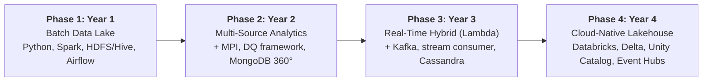
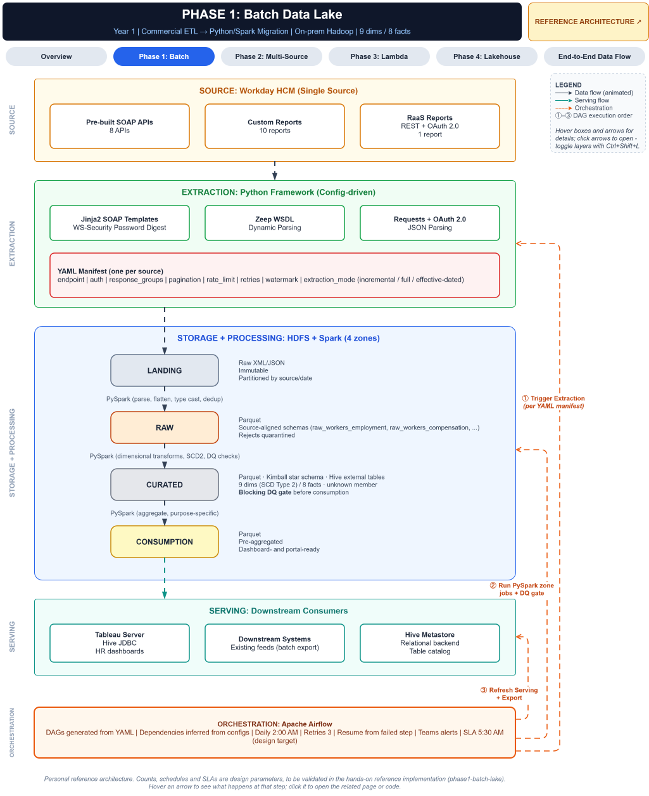
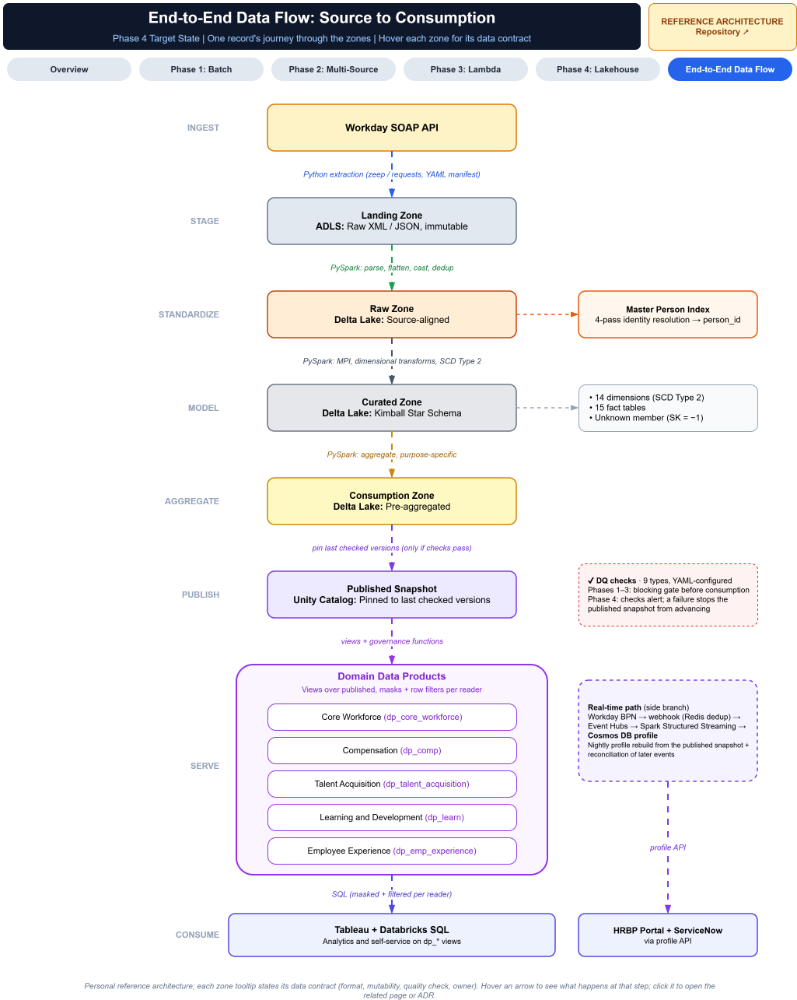

# Enterprise Data Platform Evolution: Reference Architecture

### From On-Prem Batch Lake to Real-Time Hybrid to Cloud-Native Governed Lakehouse, in Four Phases

> **About:** A reference architecture showing how an enterprise HR data platform can be modernized
> in four phases, each building on the previous one. Phases are labeled Year 1–4 as a hypothetical
> timeline. Counts, SLAs and outcomes shown in the diagrams are **design targets**. This is a personal
> design exercise and contains no proprietary names, data, code or configurations.

**Related:** For a hybrid pattern (nightly batch warehouse + event-driven lakehouse joined by zero-copy federation), see
[Hybrid-HR-Data-Platform-Reference-Architecture](https://github.com/srimarrivada/Hybrid-HR-Data-Platform-Reference-Architecture).

---

## The Problem This Roadmap Addresses

Many enterprises still run HR analytics on licensed batch ETL feeding an on-prem store, with a single
source system, nightly loads and engineering-delivered reports. Modernizing in one step is **risky**:
*Every integration, model, security rule and consumer would change at once.*

This roadmap modernizes in **four phases**. Each one delivers value on its own, reuses what came before,
and has clear exit criteria before the next begins:

1. **Batch Data Lake:** Replace licensed ETL with a config-driven Python/Spark framework on a four-zone lake.
2. **Multi-Source Analytics:** Add sources, cross-source identity resolution, a 360° profile and automated data quality.
3. **Real-Time Hybrid (Lambda):** Add event streaming for operational use cases, with the batch layer kept as the source of truth.
4. **Cloud-Native Governed Lakehouse:** Unify batch and streaming on one engine, with governed self-service through domain data products.

## At a Glance

🔗 **[Open the interactive diagrams](https://viewer.diagrams.net/?nav=1&layers=1#Uhttps://raw.githubusercontent.com/srimarrivada/Enterprise-Data-Platform-Evolution-Reference-Architecture/main/docs/diagrams/source/4-phase-platform-evolution-architecture.drawio)**: Clickable pages for each phase, tooltips and layer toggles.

## Phases

<b>Phase 1: Batch Data Lake</b>

- **YAML-driven extraction framework:** A new source is a config file, not new code
- **Four-zone lake:** Landing → Raw → Curated → Consumption, each with an explicit contract
- **Kimball star schema**: SCD Type 2, a conformed date dimension and an event fact derived from history
- **Generated pipeline:** Built from the same configs, with data quality gates in front of consumption

→ [Phase 1 Architecture](docs/architecture/phase1-batch-lake.md)

<b>Phase 2: Multi-Source Analytics</b>

- **Three new sources** (learning, survey, recruiting) through the same framework, including SFTP file drops
- **Master Person Index:** 4-pass identity resolution (exact ID → email → fuzzy → manual review)
- **360° employee profile** in a document store for the HR business partner portal
- **Configurable DQ framework** with critical/warning severity routing

→ [Phase 2 Architecture](docs/architecture/phase2-multi-source.md)

<b>Phase 3: Real-Time Hybrid (Lambda)</b>

- **Event ingestion:** Business process events → webhook receiver (two-phase Redis dedup) → Kafka
- **Ordering:** `emp_id` partitioning plus an order-independent consumer (field-level versions)
- **Speed-layer stores:** Event store (Cassandra), real-time profiles (MongoDB) and an event archive
- **Reconciliation:** Batch layer as the floor, verified against the event store

→ [Phase 3 Architecture](docs/architecture/phase3-lambda.md)

<b>Phase 4: Cloud-Native Governed Lakehouse</b>

- **ADLS Gen2 + Delta Lake:** Incremental MERGE-based SCD Type 2, time travel, restore on failure
- **Published multi-table snapshot:** Readers only see versions that passed their checks
- **Unity Catalog:** Domain data products, self-service workspaces, masking and row filters, tags
- **Managed services:** Event Hubs Kafka endpoint, Cosmos DB; infrastructure as code with Terraform

→ [Phase 4 Architecture](docs/architecture/phase4-lakehouse.md)

<b>End-to-End Data Flow</b>

→ [End-to-End Data Flow](docs/architecture/end-to-end-data-flow.md)

## Evolution Summary

| Dimension | Phase 1 | Phase 2 | Phase 3 | Phase 4 |
|---|---|---|---|---|
| Infrastructure | On-prem (Hadoop) | On-prem (Hadoop + MongoDB) | Hybrid (on-prem + Azure) | Cloud-native (Azure) |
| Processing | Batch | Batch + identity resolution | Batch + streaming (Lambda) | Unified batch + streaming |
| Storage | Hive / Parquet | + document store | + event store + archive | Delta Lake |
| Sources | 1 (HCM) | 4 batch | 4 batch + events | 4 batch + events |
| Governance | Schema registry + DQ gates | + MPI review queue | + batch/stream reconciliation | Unity Catalog (lineage, masking, audit) |
| Analytics | Engineering-delivered | BI + 360° profile | + real-time ops views | Governed self-service |
| Cost driver | ETL licensing | Hadoop capacity | Hadoop + always-on streaming | Consumption-based autoscaling |

## How Each Phase Builds on the Last

The key point of this roadmap is **reuse**: What carries forward, what changes, and how each cutover is made safely.

- [Phase 1 → Phase 2](docs/migration/phase1-to-phase2.md): Same framework, more sources; identity resolution added
- [Phase 2 → Phase 3](docs/migration/phase2-to-phase3.md): Streaming added alongside batch; reconciliation keeps them consistent
- [Phase 3 → Phase 4](docs/migration/phase3-to-phase4.md): Storage target changes from `hdfs://` to `abfss://`; Kafka clients move to Event Hubs with config changes; parallel run before cutover

## Key Architecture Decisions

Each decision has an [Architecture Decision Record](docs/adr/README.md). Decisions shared with the Hybrid repo (Kimball modeling, idempotent loads, content-based change detection, defense-in-depth security) link there rather than repeating them.

| # | Decision | Phase |
|---|---|---|
| [0001](docs/adr/0001-yaml-driven-extraction.md) | YAML-driven extraction framework | 1 |
| [0002](docs/adr/0002-four-zone-lake.md) | Four-zone lake | 1 |
| [0003](docs/adr/0003-master-person-index.md) | Master Person Index with 4-pass resolution | 2 |
| [0004](docs/adr/0004-configurable-dq-framework.md) | Configurable DQ framework with severity routing | 2 |
| [0005](docs/adr/0005-document-store-360-profile.md) | Document store for the 360° profile | 2 |
| [0006](docs/adr/0006-lambda-over-kappa.md) | Lambda over Kappa | 3 |
| [0007](docs/adr/0007-emp-id-partition-key.md) | `emp_id` partition key with an order-independent consumer | 3 |
| [0008](docs/adr/0008-webhook-dedup-redis.md) | Two-phase webhook dedup with Redis | 3 |
| [0009](docs/adr/0009-batch-stream-reconciliation.md) | Batch/stream reconciliation | 3 |
| [0010](docs/adr/0010-delta-over-hive-parquet.md) | Delta Lake over Hive/Parquet | 4 |
| [0011](docs/adr/0011-unity-catalog-domain-schemas.md) | Unity Catalog domain schemas | 4 |
| [0012](docs/adr/0012-managed-over-self-managed.md) | Managed services over self-managed | 4 |
| [0013](docs/adr/0013-phase4-orchestrator.md) | Phase 4 orchestrator choice | 4 |

## Documentation

1. **Context**
   - [Business Context](docs/business-context.md)
   - [Non-Functional Requirements](docs/nfrs.md)
   - [Roadmap and Phase Exit Criteria](docs/roadmap.md)
2. **Architecture**
   - [Phase 1](docs/architecture/phase1-batch-lake.md)
   - [Phase 2](docs/architecture/phase2-multi-source.md)
   - [Phase 3](docs/architecture/phase3-lambda.md)
   - [Phase 4](docs/architecture/phase4-lakehouse.md)
   - [End-to-End Data Flow](docs/architecture/end-to-end-data-flow.md)
3. **Decisions**
   - [Design Principles](docs/design-principles.md)
   - [ADR Index](docs/adr/README.md)
   - [Migration Notes](docs/migration/)
4. **Operating It**
   - [Failure Modes](docs/failure-modes.md)
   - [Risks and Mitigations](docs/risks.md)

## Experience Behind the Design

This design draws on hands-on work with enterprise HR data platforms: Workday integration, config-driven ingestion, change data capture, reconciliation controls, data quality frameworks, dimensional modeling and Azure Databricks. Patterns that carried over:

- Reconciliation that guarantees no data gaps → **Phase 3 batch/stream reconciliation**
- Configuration-driven source onboarding → **YAML extraction framework**
- Change detection and SCD processing → **MERGE-based SCD Type 2 on Delta Lake in Phase 4**
- Multi-source integration → **Master Person Index**
- Tiered security → **Unity Catalog domain schemas, masking and row filters**

## Confidentiality Note

This repository contains a personal reference architecture. It contains no proprietary documentation, client or system names, real data, production code, configurations, schedules or volumes.

## License

Licensed under the [MIT License](LICENSE).

## Author

**Sri Adilakshmi Marrivada**: Data Platform Architect | 19+ years 
Enterprise data architecture, cloud data platforms, data engineering and governance 
[LinkedIn](https://www.linkedin.com/in/sri-adilakshmi-marrivada/)
