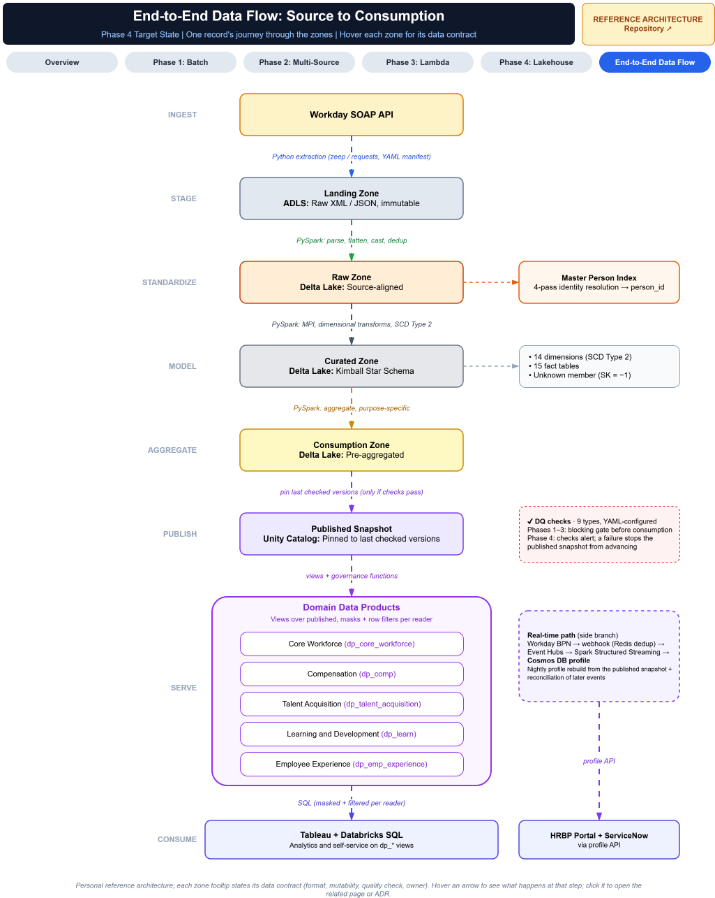

# End-to-End Data Flow

How one HR record moves from the source system to its consumers in the **Phase 4 target state**. Each zone has a **data contract** that defines its format, how it may change, the check it must pass, its owner and who may read it.



---

## Batch Path

```text
HCM SOAP / REST APIs, file drops
    ↓  config-driven extraction (one manifest per source), watermark per source
Landing        raw XML / JSON / CSV, immutable, one folder per run
    ↓  parse, flatten, type-cast; de-duplicate by key + version; bad rows to rejects
Raw            Parquet, source-aligned
    ↓  Master Person Index → one person_id per record
    ↓  SCD Type 2 history for changed members only, MERGE into Delta
Curated        Delta, Kimball star schema (dimensions, event fact)
    ↓  aggregate from the exact versions just built; checked before writing
Consumption    Delta, pre-aggregated
    ↓  publish one version per table, only after every table passed its checks
Published      views pinned to the checked snapshot
    ↓  governed views: masks and row filters per reader
Domain data products (Unity Catalog)
    ↓  query
BI · SQL · domain analysts
```

## Stream Path

```text
HCM business process events (webhooks)
    ↓  receiver: authenticate, validate, two-phase dedup, publish keyed by emp_id
Event topics (Event Hubs, Kafka endpoint)
    ↓  micro-batch consumer: idempotent writes, field versions, offsets committed last
Event store · real-time profile store · event archive
    ↑  reconciliation after each lakehouse run: batch as the floor, verified against the event store
Published dimension
```

The two paths meet at reconciliation. Batch is the truth for everything recorded before its extraction cut-off, and stream values recorded after the cut-off are kept. → [Phase 3](phase3-lambda.md), [ADR-0009](../adr/0009-batch-stream-reconciliation.md)

---

## Zone Contracts

| Zone | Format | How It Changes | Check Before It's Visible | Owner | Who Reads It |
|---|---|---|---|---|---|
| **Landing** | Raw XML / JSON / CSV | Append-only; never modified | Run complete (success marker); arrival checks for files | Platform team | Platform jobs only |
| **Raw** | Parquet | Rebuilt from Landing each run | Schema matches the source's expectations; reject rate within limit | Platform team | Platform jobs only |
| **Curated** | Delta | MERGE for changed members; history corrected, never overwritten | Structural checks on the change set before commit, on the full table after; restore on failure | Platform team | Through published views only |
| **Consumption** | Delta | Rebuilt each run | Reconciled with the dimension and fact before writing; DQ suites | Platform team | Through published views only |
| **Published** | Views | Repointed once per successful run | Every table in the set passed | Platform team | Data product views |
| **Domain data products** | Views | Changed through reviewed SQL | Governance functions applied; access tested per group | Domain owners | Domain groups (`SELECT`) |

If a check fails, the previous version stays visible. → [ADR-0002](../adr/0002-four-zone-lake.md), [ADR-0010](../adr/0010-delta-over-hive-parquet.md)

---

## Identity Resolution

The Master Person Index runs between Raw and Curated, so every curated table joins on one `person_id`, whichever source the record came from. Uncertain matches go to a review queue instead of being guessed. → [ADR-0003](../adr/0003-master-person-index.md)

---

## Domain Data Products

| Product | Typical Content | Governance |
|---|---|---|
| Core Workforce | Current workers, headcount, hires, terminations and changes | Email masked unless restricted group; rows filtered by business unit |
| Compensation | Pay, grades, compensation events | Compensation values for the compensation team only |
| Talent Acquisition | Requisitions, candidate pipeline, offers | Domain group only |
| Learning and Development | Courses, completions, certifications, compliance | Domain group only |
| Employee Experience | Engagement and survey results | Domain group only |

Products are views over the published snapshot, not copies. → [ADR-0011](../adr/0011-unity-catalog-domain-schemas.md)

---

## Replay and Recovery Along the Flow

| If This Breaks | Recover From |
|---|---|
| Raw parsing or mapping | Rebuild Raw from Landing |
| Curated history or MERGE | Table restored automatically; fix and re-run (same members, same result) |
| One table in a run fails | Published snapshot doesn't move; readers keep the last consistent set |
| Consumption aggregates | Rebuild from the published Curated versions |
| Stream stores | Replay from topic retention or the event archive; idempotent writes leave correct state |
| Stream disagrees with batch | Reconciliation corrects stale values; verification flags events not applied |

→ [Failure Modes](../failure-modes.md)

---

## Related Documents

- [Phase 1: Batch Data Lake](phase1-batch-lake.md)
- [Phase 3: Real-Time Hybrid](phase3-lambda.md)
- [Phase 4: Cloud-Native Lakehouse](phase4-lakehouse.md)
- [ADR Index](../adr/README.md)

---

*This document describes a generalized reference architecture and does not describe any specific organization's implementation.*