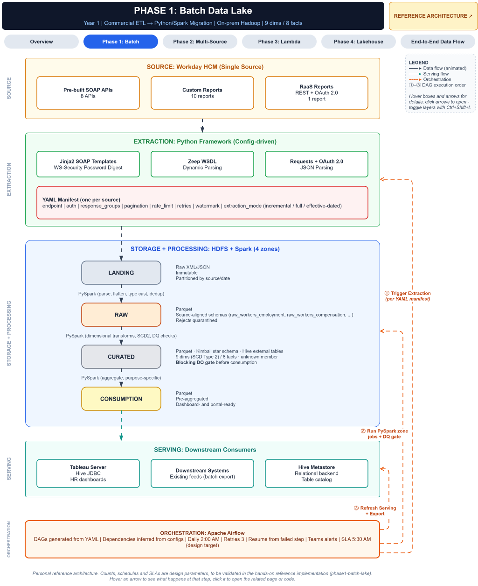
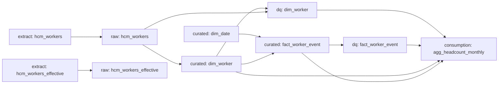

# Phase 1: Batch Data Lake

**Year 1 - On-premises. Batch only**

## Goal

Replace licensed batch ETL with a **config-driven Python/Spark framework** on a four-zone data lake. The result is a single, trusted, history-aware source of HR analytics from the HCM system of record, with quality gates in front of everything consumers read.



---

## Sources

A single HCM system of record (e.g., Workday), accessed three ways:

| Interface | Protocol | Use |
|---|---|---|
| Pre-built web service APIs | SOAP, WS-Security UsernameToken over HTTPS | Core worker, position and organization data |
| Custom report web services | SOAP (templated requests; WSDL-driven where available) | Business-specific extracts |
| Report-as-a-Service | REST, OAuth 2.0, JSON | Lightweight reports |

Two extraction modes run against the same interfaces:
- **Incremental:** Changes recorded since the last successful run (watermark-based).
- **Effective-dated:** A look-back and look-forward window by effective date, to catch back-dated corrections and future-dated changes.

---

## Extraction Framework

A Python framework that reads a **YAML manifest per source**. Adding a source means adding a file, not writing code. → [ADR-0001](../adr/0001-yaml-driven-extraction.md)

| Concern | Handled by the Framework |
|---|---|
| Authentication | WS-Security for SOAP; OAuth 2.0 client credentials for REST (token cached and refreshed) |
| Paging | Page/count for SOAP; cursor or single response for REST |
| Rate limits and transient errors | Client-side throttling; retries with exponential backoff, respecting the source's retry hints |
| State | Watermark per source, advanced only after the payload is published |
| Landing writes | Pages written to a hidden in-progress folder, then published in one step with a success marker |
| Audit | Run log for every run: window, pages, records, retries, duration, error |

**Example Manifest:**

```yaml
source: hcm_workers
interface: soap
operation: Get_Workers
endpoint: ${HCM_BASE_URL}/ccx/service/${HCM_TENANT}/Human_Resources
auth:
  type: ws_security
  username: ${HCM_USERNAME}
  password: ${HCM_PASSWORD}
response_groups: [personal, employment, compensation]
extraction_mode: incremental          # incremental | full | effective_dated
pagination: { page_size: 200 }
rate_limit: { requests_per_second: 5 }
watermark:
  initial: "2000-01-01T00:00:00Z"
  overlap_seconds: 0
target_path: ${LAKE_ROOT}/landing/hcm_workers
```

Secrets are referenced as environment variables and never stored in manifests or logs. **Extraction** is **at-least-once**: A window may return a record that a later window returns again, and the **Raw zone** removes the duplicates. → [Idempotent loads (Hybrid D9)](https://github.com/srimarrivada/Hybrid-HR-Data-Platform-Reference-Architecture/blob/main/docs/adr/0009-idempotent-loads.md)

---

## Four-Zone Lake

→ [ADR-0002](../adr/0002-four-zone-lake.md)

| Zone | Format | Contract | Transformation into it |
|---|---|---|---|
| **Landing** | Raw XML / JSON | Exactly as received; immutable, append-only; one folder per run, partitioned by source and extraction date | Extraction framework |
| **Raw** | Parquet | Source-aligned, typed and flattened; no business logic; rebuilt from Landing every run | Parse, flatten, type-cast; de-duplicate by key + version (latest run wins); bad records to a rejects table with a reason |
| **Curated** | Parquet + Hive external tables | Kimball model, conformed, SCD Type 2; rebuilt from Raw every run | SCD2 history, event derivation, structural checks before publish |
| **Consumption** | Parquet | Purpose-built aggregates for dashboards and feeds | Aggregation and reconciliation checks, behind DQ gates |

Each zone is published by swapping a fully written folder into place, so readers see the old version or the new one, never a partial one. If a job fails, the previous version stays live. If too many records are rejected, the Raw run fails and Raw is unchanged.

Parsing is done record by record with a hardened XML parser, so one bad record is rejected with a reason instead of failing the whole file. At much larger volumes, a Spark-native XML reader is the option to revisit.

---

## Data Model

A Kimball star schema with conformed dimensions and SCD Type 2 history. → [Kimball model (Hybrid D10)](https://github.com/srimarrivada/Hybrid-HR-Data-Platform-Reference-Architecture/blob/main/docs/adr/0010-kimball-dimensional-model.md)

### Worker Dimension (SCD Type 2)

| Rule | Behavior |
|---|---|
| History axis | Business time: each row covers `effective_from` to `effective_to` (exclusive); the open row ends 9999-12-31 |
| Type 2 columns | Status, termination date, job family and profile, grade, business unit, location, manager: a change creates a new row |
| Type 1 columns | Name, email, hire date: corrections overwrite every row, no history |
| Change detection | Content compare of Type 2 columns: a re-pull or a Type 1-only change creates no row → [Hybrid D8](https://github.com/srimarrivada/Hybrid-HR-Data-Platform-Reference-Architecture/blob/main/docs/adr/0008-change-detection-strategy.md) |
| Corrections and back-dated changes | Several versions on one effective date: the latest recording wins; back-dated changes are sorted into place |
| Future-dated changes | Kept, not current until their date |
| Keys | Deterministic surrogate key (stable across rebuilds); an unknown-member row for facts that arrive early → [Hybrid D13](https://github.com/srimarrivada/Hybrid-HR-Data-Platform-Reference-Architecture/blob/main/docs/adr/0013-fact-design-patterns.md) |
| Compensation | Not in the worker dimension: it belongs in a restricted fact, so pay changes don't create worker history → [Hybrid D11](https://github.com/srimarrivada/Hybrid-HR-Data-Platform-Reference-Architecture/blob/main/docs/adr/0011-defense-in-depth-security.md) |

**Structural checks block the publish:** Exactly one current row per worker, no gaps or overlaps, unique surrogate keys, and the unknown member present.

### Date Dimension
One row per day with calendar and fiscal attributes (configurable fiscal year start), keyed by `yyyymmdd`, plus an unknown-member row. Every fact joins to it.

### Worker Event Fact
A transaction fact with one row per hire, termination, rehire, status change, job change, grade change, organization change and manager change. Events are **derived from consecutive rows of the worker dimension**, because Phase 1 sources provide state snapshots, not events. Change event types are configuration. Future events are flagged, and event keys are deterministic.

### Monthly Headcount (Consumption)
Headcount at each month end (as of the run date for the current month), with hires and terminations, by business unit, job family and location. A worker is counted as active on a date when it falls on or after their hire date and before their termination date. This uses dates rather than status, so it stays correct for workers first seen after they had left. Before publishing, the aggregate is reconciled with the dimension (current headcount) and the fact (hire and termination totals).

### Further Model (Design Target)
The full Phase 1 model adds:
- **Dimensions:** Position, organization, location, job profile, job family, compensation grade, business process type.
- **Facts:** Daily and monthly headcount, compensation events (restricted), absence balances, benefit elections, performance ratings, business process transactions.

All follow the same patterns.

### Known Limitations
- **History before the first extraction:** Months before the platform's first extraction use the first attributes it saw. Full history needs a one-time effective-dated historical extract. → [R-04](../risks.md#phase-1--batch-data-lake)
- **One time axis:** When a back-dated change arrives after a later change, its row carries the latest known values for the other columns. Full bitemporal history needs the effective-dated extract, or MERGE with change data in Phase 4.

---

## Data Quality Gates

Quality gates are part of Phase 1, so the first dashboards are already protected. They were originally planned for Phase 2. → [ADR-0004](../adr/0004-configurable-dq-framework.md)

- **Structural checks** run inside each job and block that table's publish.
- **Configurable suites** (YAML, one per table) run after the Curated tables and **gate** the Consumption tables they protect. Check types include not-null, uniqueness, referential integrity, accepted values, value ranges, SCD2 consistency, cross-zone reconciliation, row-count change and distribution drift.
- **Critical** failures skip the gated tables, so dashboards keep the last good version. **Warnings** alert without blocking.
- Volume and distribution checks compare with the last *passing* run, so one bad day can't become the new normal.

---

## Orchestration

**One pipeline per phase, generated from the configs:**
- Each config declares what it reads and what it produces, so dependencies are inferred, not wired by hand.
- A new source adds its tasks automatically.
- Missing producers and cycles are rejected before anything runs.



- **Scheduler:** Apache Airflow runs the plan. The same plan can run locally or on another orchestrator (see [ADR-0013](../adr/0013-phase4-orchestrator.md)).
- **One run at a time:** Watermarks assume it.
- **Shared as-of date:** One per run, so dimension, fact and aggregate agree on "current".
- **Failures:** Retries with backoff, and alerts on failure. A failed task skips only its dependents; independent branches still run.
- **Catch-up:** No catch-up runs. Historical reprocessing means rebuilding from Landing, not re-extracting.

---

## Serving

- **BI** (e.g., Tableau) over Hive JDBC for HR dashboards, reading Consumption only
- **Downstream systems:** Batch file exports from Consumption
- **Hive Metastore** as the schema registry

---

## Design Targets

These are design parameters, not measured results:

| Parameter | Target |
|---|---|
| Source interfaces | 8 SOAP APIs + 10 custom reports + 1 RaaS report |
| Data model | 9 dimensions (SCD2) + 8 facts |
| Orchestration | One generated pipeline per phase (replaces an earlier estimate of ~17 hand-built DAGs) |
| Schedule | Nightly start; Consumption ready before business start |
| Retries | Extraction retried per request and per task; transformations retried per task |
| Reject tolerance | Raw run fails above a configured reject rate |

---

## Failure Handling

| Failure | Designed outcome |
|---|---|
| Extraction fails part-way | Nothing published; watermark unchanged; same window next run → [F1](../failure-modes.md#f1-extraction-fails-part-way) |
| Critical DQ check fails | Consumption not rebuilt; previous version stays live → [F2](../failure-modes.md#f2-critical-data-quality-check-fails) |
| History integrity check fails | Dimension not published; previous version stays live → [F3](../failure-modes.md#f3-history-integrity-check-fails) |

---

## Exit Criteria

Phase 1 is complete when:
- All HCM interfaces land through the framework with no source-specific code
- Every zone can be rebuilt from Landing
- SCD2 history is valid: exactly one current row per worker, no gaps or overlaps
- Re-running any job produces identical results
- Dashboards and feeds read only from the Consumption zone, behind passing DQ gates

→ [Roadmap](../roadmap.md#phase-1--batch-data-lake-year-1)  
→ **Next:** [Phase 1 → Phase 2](../migration/phase1-to-phase2.md)

---

## Related Documents

- [Phase 2: Multi-Source Analytics](phase2-multi-source.md)
- [End-to-End Data Flow](end-to-end-data-flow.md)
- [Risks: Phase 1](../risks.md#phase-1--batch-data-lake)
- [ADR Index](../adr/README.md)

---

*This document describes a generalized reference architecture and does not describe any specific organization's implementation.*
