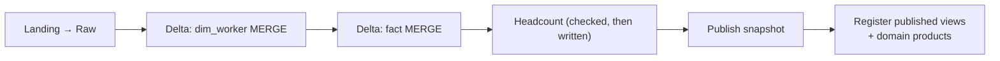

# Phase 4: Cloud-Native Governed Lakehouse

**Year 4 - Fully on Azure. Unified Batch + Streaming**

## Goal

Move every layer to the cloud and run batch and streaming on **one platform**. Process only what changed, and let readers see only data that passed its checks. Open governed **self-service** to domain teams through Unity Catalog data products. Replace self-managed services with **managed** ones, and define every resource as code.

---

## What Changes from Phase 3

| Component | Phase 3 | Phase 4 | Decision |
|---|---|---|---|
| Lake storage | HDFS | ADLS Gen2 | Storage target in configuration (`hdfs://` → `abfss://`) |
| Table format | Parquet + Hive Metastore | Delta Lake + Unity Catalog | [ADR-0010](../adr/0010-delta-over-hive-parquet.md), [ADR-0011](../adr/0011-unity-catalog-domain-schemas.md) |
| Processing | Full rebuild of every table | Incremental MERGE; published multi-table snapshot | [ADR-0010](../adr/0010-delta-over-hive-parquet.md) |
| Compute | On-premises Spark | Azure Databricks | [ADR-0013](../adr/0013-phase4-orchestrator.md) |
| Event broker | Self-managed Kafka | Event Hubs (Kafka endpoint) | [ADR-0012](../adr/0012-managed-over-self-managed.md) |
| Profile store | Self-managed MongoDB | Cosmos DB for MongoDB | [ADR-0012](../adr/0012-managed-over-self-managed.md) |
| Event store | Cassandra | Cassandra for now; target: a Delta event table | [ADR-0012](../adr/0012-managed-over-self-managed.md) |
| Orchestration | Airflow | Databricks Workflows, deployed as code | [ADR-0013](../adr/0013-phase4-orchestrator.md) |
| Access | Tiered zones | Domain data products with masks, row filters, tags, audit | [ADR-0011](../adr/0011-unity-catalog-domain-schemas.md) |
| Infrastructure | Hand-built | Terraform for every cloud resource | n/a |

**Unchanged:** the extraction framework and manifests, the four zones and their contracts, the SCD2 and event-derivation logic, the DQ rules, identity resolution, and reconciliation.

---

## Storage: ADLS Gen2 + Delta Lake

| Zone | Format | Notes |
|---|---|---|
| Landing | Raw JSON / XML / CSV | Immutable; on a Unity Catalog volume |
| Raw | Parquet (Delta as a later step) | Source-aligned; rebuilt from Landing |
| Curated | Delta | Star schema; ACID; time travel; incremental MERGE; data layout clustered on the member key and effective date (e.g., liquid clustering or Z-ORDER) |
| Consumption | Delta | Aggregates, checked before they are written |

Delta tables live under their own root and are **never read as plain Parquet**, because a Delta folder contains files that later commits have removed. Table maintenance (OPTIMIZE, VACUUM) runs as a scheduled job. VACUUM retention stays long enough for restore and time travel.

---

## Incremental Processing

### Dimensions: SCD2 by MERGE
1. **Find affected members:** Members with Raw versions newer than the last processed run.
2. **Recompute their full history** with the same SCD2 function as Phase 1. This handles back-dated changes and corrections, which close-and-insert MERGE patterns get wrong.
3. **MERGE on the surrogate key:**
   - Update rows whose content changed (null-safe compare of every column)
   - Insert new rows
   - **Delete** affected members' rows that the new history no longer contains
4. **Refresh `is_current`** for the as-of date, so future-dated rows become current on their date.

Members that didn't change are not touched.

### Facts: Incremental by Dimension Comparison
1. **Find affected members** by comparing the dimension's fact-relevant columns between the version last processed and the current one.
2. **Recompute only those members' events** and MERGE them: update, insert, delete.
3. **Refresh `is_future`** daily.

Comparing versions works without enabling a table property, and it handles a restore correctly. At larger scale, Change Data Feed is the cheaper option.

### Aggregates: Rebuilt, Checked Before Writing
Headcount is small, so it's rebuilt in full from **exactly the dimension and fact versions** the run produced. Its reconciliation checks run **before** the write, so a failure writes nothing.

### Audit, Commit, Verify
- **Before commit:** Structural checks run on the change set. A failure leaves the table unchanged.
- **After commit:** Checks run on the full table. A failure **restores** the table to the version before the run.
- **Progress markers** (last processed run, dimension version) are saved only after success. A re-run recomputes the same members with the same result. → [Idempotent loads (Hybrid D9)](https://github.com/srimarrivada/Hybrid-HR-Data-Platform-Reference-Architecture/blob/main/docs/adr/0009-idempotent-loads.md)

---

## Published Snapshot

Delta commits one table at a time. It has **no transaction across tables**, so a reader of "latest" could see a new dimension next to an old fact.

- After **every table in the run** passes its checks, one pointer records **a version per table**: dimension, fact and aggregate.
- Readers use those versions, so they always see a set that was built and checked together.
- If any table fails, the pointer **doesn't move**, and readers keep the previous consistent set.
- Readers of the published snapshot never see a bad commit, even during the moment between a bad commit and its restore.

In Unity Catalog, the pointer is exposed as **views in a `published` schema**, each pinned to its table's published version. → [ADR-0010](../adr/0010-delta-over-hive-parquet.md)

---

## Streaming

- **Event Hubs** with the Kafka protocol endpoint (Standard tier or above):
  - the same five topics, still keyed by `emp_id`
  - SASL_SSL authentication, with separate send and listen credentials
  - Phase 3 producers and consumers move over with **configuration changes only**
- **Idempotent producer** is off by default on the managed broker. The receiver's two-phase dedup and the idempotent sinks already absorb duplicates. → [ADR-0008](../adr/0008-webhook-dedup-redis.md)
- **The consumer** keeps its Phase 3 logic and guarantees (field versions, at-least-once with idempotent writes, optimistic concurrency) and writes profiles to **Cosmos DB**. At scale, the same batch logic runs inside Spark Structured Streaming (`foreachBatch`) on Databricks.
- **Reconciliation** runs after each lakehouse run, using the published dimension. → [ADR-0009](../adr/0009-batch-stream-reconciliation.md)

Batch and streaming now share one platform, one storage layer and one catalog, but reconciliation stays: batch is still the floor.

---

## Governance: Unity Catalog

One catalog (e.g., `hr_platform`), with schemas of four kinds. → [ADR-0011](../adr/0011-unity-catalog-domain-schemas.md)

| Schema type | Examples | Owner | Access |
|---|---|---|---|
| **Platform-managed** | `curated`, `consumption`, `governance`, `ops` | Platform team | Platform engineers only |
| **Published** | `published` | Platform team | Views pinned to the checked snapshot; read by data products, not by people |
| **Domain data products** (read) | `dp_core_workforce`, `dp_comp`, `dp_talent_acquisition`, `dp_learn`, `dp_emp_experience` | Domain owners | `SELECT` for the domain group |
| **Domain workspaces** (write) | `ws_comp`, `ws_talent_acquisition` | Domain teams | Create and modify their own tables |

- **Data products are views over `published`,** not copies.
- **Masks and row filters are applied inside the product views,** using governance functions evaluated for each reader by group membership:
  - email masked unless the reader is in the restricted group
  - compensation visible only to the compensation team
  - rows filtered by business unit
- **Why in the views, not on the base tables:** platform jobs access Delta tables by path, and path access is blocked on tables that have masks or row filters. Moving the controls to the base tables is the revisit option once jobs read and write by table name.
- **No base-table grants for domain groups.** Views run with their owner's access to the underlying tables, so readers need `SELECT` on the product view only.
- **Tags** record domain, owner, freshness target and PII status on every product.
- **Grants live in versioned SQL,** not clicks. Lineage and audit logs come from the catalog.

→ [Defense in depth (Hybrid D11)](https://github.com/srimarrivada/Hybrid-HR-Data-Platform-Reference-Architecture/blob/main/docs/adr/0011-defense-in-depth-security.md)

---

## Serving and Consumption

| Store / tool | Serves |
|---|---|
| Domain data products (Unity Catalog views) | Domain analysts, BI tools (e.g., Power BI, Tableau), Databricks SQL |
| Cosmos DB (profile) | HR business partner portal, IT service management onboarding |
| Event store | Real-time operations dashboard |

BI tools and domain teams read **data products only**, never base or latest tables.

---

## Orchestration

**Databricks Workflows, deployed as code** (Asset Bundle). → [ADR-0013](../adr/0013-phase4-orchestrator.md)

- **One job cluster** is shared by all tasks and stops when the run ends.
- **Dedicated (single-user) compute:** Processing uses RDD APIs, which serverless and shared compute don't support. Moving those steps to DataFrame APIs is the path to serverless.
- **Exit codes** become task failures, so a failed step stops its dependents.
- **One run at a time.**

---

## Infrastructure as Code and Cost

Terraform defines every resource, in two stacks:
1. **Infrastructure:** Resource group, ADLS Gen2, Databricks workspace (Premium, required for Unity Catalog), access connector, Event Hubs, Cosmos DB (serverless), budget alert.
2. **Workspace:** Storage credential, external locations, catalog, operational schema and volumes.

Two stacks are needed because the workspace provider needs the workspace URL, which exists only after the first stack is applied.

**Cost Guardrails:**
- Compute runs only while jobs run
- Cosmos DB tier is consumption-based
- Event Hubs is the only always-on capacity, because operational freshness needs it
- Subscription budget alerts at set thresholds
- Non-production environments are torn down when not in use

→ [NFR-14](../nfrs.md), [R-17](../risks.md#phase-4--cloud-native-governed-lakehouse)

---

## Design Targets

These are design parameters and hypotheses, not measured results:

| Parameter | Target |
|---|---|
| Event Hubs | 5 topics · 3 partitions · 7-day retention · Kafka endpoint |
| Cosmos DB | Serverless (demo and moderate load); autoscale throughput for production |
| Domain data products | 5 product schemas · 2 workspaces |
| Incremental work | Proportional to the number of changed members |
| Readers | Only published versions; no reader sees an unchecked table |
| Self-service | Domain teams query products without engineering tickets |

---

## Failure Handling

| Failure | Designed outcome |
|---|---|
| Bad table version committed | Table restored; published snapshot unchanged → [F11](../failure-modes.md#f11-bad-table-version-committed) |
| One table in a set fails | Pointer doesn't move; readers keep the last consistent set → [F12](../failure-modes.md#f12-one-table-in-a-set-fails) |
| Old and new platforms disagree during migration | Cutover held; Phase 3 stays live → [F13](../failure-modes.md#f13-old-and-new-paths-disagree-during-migration) |

The Phase 3 stream failure modes ([F6–F10](../failure-modes.md#phase-3--real-time-hybrid)) still apply, with the same designed outcomes on the managed services.

---

## Exit Criteria

Phase 4 is complete when:
- A parallel run with Phase 3 reconciles row counts and SCD2 history across all zones
- Stream clients run against the managed broker with configuration changes only
- Masking, row filters and grants are verified with test users for each schema type
- Lineage is visible from source to consumption
- Environment can be recreated from code and torn down cleanly

→ [Roadmap](../roadmap.md#phase-4--cloud-native-governed-lakehouse-year-4) · Previous: [Phase 3 → Phase 4](../migration/phase3-to-phase4.md)

---

## Related Documents

- [Phase 3: Real-Time Hybrid](phase3-lambda.md)
- [End-to-End Data Flow](end-to-end-data-flow.md)
- [Risks: Phase 4](../risks.md#phase-4--cloud-native-governed-lakehouse)
- [ADR Index](../adr/README.md)

---

*This document describes a generalized reference architecture and does not describe any specific organization's implementation.*