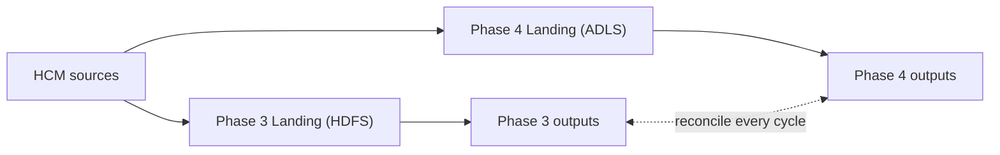

# Migration: Phase 3 → Phase 4

**Character:** Re-platform. Every layer moves to the cloud lakehouse, and every consumer moves with it. This is the migration where a parallel run matters most. The new platform must produce the same results before anyone relies on it.

## Starting and Ending State

| Component | Phase 3 | Phase 4 | Decision |
|---|---|---|---|
| Lake storage | HDFS | ADLS Gen2 | Storage target in configuration |
| Table format | Parquet + Hive Metastore | Delta Lake + Unity Catalog | [ADR-0010](../adr/0010-delta-over-hive-parquet.md), [ADR-0011](../adr/0011-unity-catalog-domain-schemas.md) |
| Processing | Full rebuilds | Incremental MERGE; published multi-table snapshot | [ADR-0010](../adr/0010-delta-over-hive-parquet.md) |
| Event broker | Self-managed Kafka | Event Hubs (Kafka endpoint) | [ADR-0012](../adr/0012-managed-over-self-managed.md) |
| Profile store | Self-managed MongoDB | Cosmos DB (MongoDB API) | [ADR-0012](../adr/0012-managed-over-self-managed.md) |
| Orchestration | Airflow | Lakehouse-native workflows | [ADR-0013](../adr/0013-phase4-orchestrator.md) |
| Access | Tiered zones | Domain data products with masking, row filters, audit | [ADR-0011](../adr/0011-unity-catalog-domain-schemas.md) |
| Connectivity | On-premises ↔ cloud link | Not needed once cut over | n/a |

## Reused with Configuration Changes Only
- **Extraction framework and manifests:** Only the storage target changes (`hdfs://` → `abfss://`).
- **Stream clients:**
  - Producer and consumer settings point to the managed broker (security protocol and credentials)
  - The profile store moves by connection string
- **SCD2 and event-derivation logic:** Same functions are used, now applied incrementally.
- **DQ rules, identity resolution and reconciliation rules.**

## Parallel Run and Comparison



1. **Batch - Land once, build twice:** The same extraction writes to both lakes, or Landing is copied to the cloud after each run. Both platforms build from identical inputs. Each cycle compares:
   - Row counts per zone
   - SCD2 history per member
   - Event fact counts by type
   - Headcount by month and business unit
   - Identity crosswalk links
2. **Stream - Run both brokers:** Topics are mirrored to the managed broker, or the receiver publishes to both. The cloud consumer writes to the managed profile store in shadow mode. Profiles are compared with the Phase 3 profiles after each reconciliation.
3. **Governance tested with real group memberships before anyone gets access:**
   - Masked versus unmasked values
   - Filtered rows per business unit
   - Denied access to base tables
4. **Failure drills on the new platform:**
   - A bad commit is restored
   - A failed table in a set leaves the published snapshot unchanged
   - Broker failover is handled
   → [F11–F12](../failure-modes.md#phase-4--cloud-native-governed-lakehouse)

## Cutover
- **By domain, not report by report:** Core workforce first, then each domain data product. Each KPI has one owning platform at a time. → [R-22](../risks.md#migration-risks)
- **BI tools and domain teams are repointed to the published views:** Nobody reads base tables.
- **Operational integrations move to the managed broker:** One at a time, with the self-managed broker still receiving events.
- **Rollback:** Repoint consumers to Phase 3 outputs, which keep running and stay reconciled during the parallel run.
- **Decommissioning is a separate, approved step,** and happens only after the exit criteria are met:
  - Self-managed broker and document store
  - HDFS and Airflow
  - On-premises ↔ cloud link

  → [R-23](../risks.md#migration-risks)

## Exit Criteria
Same as the [Roadmap](../roadmap.md#phase-4--cloud-native-governed-lakehouse-year-4):
- Parallel run reconciles counts and SCD2 history across all zones
- Stream clients run against the managed broker with configuration changes only
- Masking, row filters and grants are verified with test users
- Lineage is visible from source to consumption
- Environment can be recreated from code and torn down cleanly

## Main Risks
- Cutover before the new path is proven → [R-21](../risks.md#migration-risks), [F13](../failure-modes.md#f13-old-and-new-paths-disagree-during-migration)
- Governance gap on a new data product → [R-16](../risks.md#phase-4--cloud-native-governed-lakehouse)
- Managed-service differences → [R-18](../risks.md#phase-4--cloud-native-governed-lakehouse)
- Cost overrun during the double-running period → [R-17](../risks.md#phase-4--cloud-native-governed-lakehouse)

## Related
- [Phase 3](../architecture/phase3-lambda.md) 
- [Phase 4](../architecture/phase4-lakehouse.md) 
- [Previous](phase2-to-phase3.md)

---

*This document describes a generalized reference architecture and does not describe any specific organization's implementation.*
```
