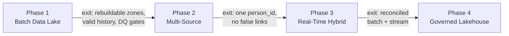

# Roadmap and Phase Exit Criteria

The platform evolves in four phases. Each phase delivers value on its own, reuses what came before, and must meet its exit criteria before the next phase starts. Phases are labeled Year 1–4 as a hypothetical timeline; the order matters more than the duration.

## Overview

| Phase | Goal | Adds | Answers (see [Business Context](business-context.md)) |
|---|---|---|---|
| **1. Batch Data Lake** | Replace licensed ETL with a config-driven framework and a trusted daily model | Four-zone lake, SCD2 dimension, event fact, DQ gates, generated pipeline | BQ1–BQ3 |
| **2. Multi-Source Analytics** | Link people across sources and widen the analytical scope | Three sources (incl. file drops), Master Person Index, 360° profile, per-source DQ rules | BQ4–BQ7 |
| **3. Real-Time Hybrid** | Make operational changes available in minutes without losing the daily truth | Webhook ingestion, event streaming, event and profile stores, reconciliation | BQ8–BQ9 |
| **4. Cloud-Native Lakehouse** | One platform, governed self-service, incremental processing | Delta Lake, published snapshots, Unity Catalog domain products, managed services, infrastructure as code | BQ10–BQ11 |

---

## Phase 1: Batch Data Lake (Year 1)

**Goal:** A single, trusted, history-aware source of HR analytics from the HCM system of record, without licensed ETL.

**Entry Criteria**
- Access to the HCM interfaces (SOAP APIs, custom reports, RaaS) in a non-production tenant
- Agreed sensitivity tiers for HR data

**Delivers**
- Config-driven extraction (one YAML manifest per source) with watermarks → [ADR-0001](adr/0001-yaml-driven-extraction.md)
- Four-zone lake with a contract per zone → [ADR-0002](adr/0002-four-zone-lake.md)
- SCD Type 2 worker dimension, conformed date dimension, event fact derived from history, monthly headcount
- Data quality gates in front of consumption. These were planned for Phase 2 and moved forward, so the first dashboards are already gated → [ADR-0004](adr/0004-configurable-dq-framework.md)
- One pipeline per phase, generated from the configs

**Exit Criteria** ([details](architecture/phase1-batch-lake.md#exit-criteria))
- All HCM interfaces land through the framework with no source-specific code
- Every zone can be rebuilt from Landing
- SCD2 history is valid: exactly one current row per worker, no gaps or overlaps
- Re-running any job produces identical results
- Dashboards and feeds read only from the Consumption zone, behind passing DQ gates

---

## Phase 2: Multi-Source Analytics (Year 2)

**Goal:** Answer questions that need more than one source, about the same person.

**Entry Criteria**
- Phase 1 exit criteria met
- Access agreed for the learning platform (REST), survey platform (SFTP) and recruiting module

**Delivers**
- Three new sources through the unchanged framework, including file drops with settle-time handling
- Master Person Index: exact ID → email → fuzzy → manual review, with a review queue → [ADR-0003](adr/0003-master-person-index.md)
- 360° employee profile in a document store → [ADR-0005](adr/0005-document-store-360-profile.md)
- Per-source DQ rules on the new sources

**Reuses Unchanged:** the extraction framework, zones, SCD2 logic, pipeline generation and DQ framework.

**Exit Criteria** ([details](architecture/phase2-multi-source.md#exit-criteria))
- All four sources run through the unchanged framework
- Identity resolution produces no false links on a known-answer test set, and unresolved records reach the review queue
- A critical DQ failure holds the publish and raises an alert
- The profile is rebuilt after each batch and served to the HR business partner portal

---

## Phase 3: Real-Time Hybrid (Year 3)

**Goal:** Operational changes within minutes, while the validated daily batch stays the source of truth.

**Entry Criteria**
- Phase 2 exit criteria met
- The HCM system can push business process notifications
- Private connectivity between on-premises and cloud is in place

**Delivers**
- Webhook receiver with two-phase dedup → [ADR-0008](adr/0008-webhook-dedup-redis.md)
- Event topics partitioned by `emp_id`, consumed by an order-independent consumer → [ADR-0007](adr/0007-emp-id-partition-key.md)
- Event store, real-time profile store and event archive
- Batch/stream reconciliation with the batch as the floor → [ADR-0009](adr/0009-batch-stream-reconciliation.md)

**Reuses Unchanged:** the whole batch layer, which stays the source of truth → [ADR-0006](adr/0006-lambda-over-kappa.md)

**Exit Criteria** ([details](architecture/phase3-lambda.md#exit-criteria))
- End-to-end event latency, from the change to the profile update, is measured and within target
- Duplicate delivery, consumer restart, offset replay and late events all leave stored state correct
- Reconciliation verifies every profile against batch plus newer events, with no mismatches
- The batch layer is unchanged and remains the source of truth

---

## Phase 4: Cloud-Native Governed Lakehouse (Year 4)

**Goal:** One platform for batch and streaming, incremental processing, and governed self-service for domain teams.

**Entry Criteria**
- Phase 3 exit criteria met
- Cloud landing zone, identity groups and cost guardrails agreed

**Delivers**
- Delta Lake with incremental MERGE for dimensions and facts, restore on failure, and a published multi-table snapshot → [ADR-0010](adr/0010-delta-over-hive-parquet.md)
- Unity Catalog: platform schemas, domain data products, domain workspaces, masking and row filters, tags → [ADR-0011](adr/0011-unity-catalog-domain-schemas.md)
- Managed services in place of self-managed ones (Kafka endpoint on Event Hubs, document store on Cosmos DB) → [ADR-0012](adr/0012-managed-over-self-managed.md)
- Orchestration on the lakehouse platform, deployed as code → [ADR-0013](adr/0013-phase4-orchestrator.md)
- Infrastructure as code for every cloud resource

**Reuses with configuration changes only:** the extraction framework and manifests (storage target), stream clients (broker settings), DQ rules, reconciliation logic.

**Exit Criteria** ([details](architecture/phase4-lakehouse.md#exit-criteria))
- A parallel run with Phase 3 reconciles row counts and SCD2 history across all zones
- Stream clients run against the managed broker with configuration changes only
- Masking, row filters and grants are verified with test users for each schema type
- Lineage is visible from source to consumption
- The environment can be recreated from code and torn down cleanly

---

## Rules That Apply Across Phases

- **No phase starts before the previous one exits.** Exit criteria are checked, not assumed.
- **Parallel run before every cutover.** Old and new paths run side by side until reconciliation shows they agree. See the [migration notes](migration/).
- **Rollback stays possible** until the exit criteria are met. The previous phase's path is switched off only after that.
- **Reuse is the default.** A phase replaces a component only when an ADR records why.
- **Synthetic or masked data** in every non-production environment.

## Later Options (Not on the Roadmap)

| Option | When it would make sense |
|---|---|
| Stream-only processing (Kappa) | If the source guarantees complete, ordered, replayable events ([ADR-0006](adr/0006-lambda-over-kappa.md)) |
| Single event topic instead of per-type topics | If a consumer needs strict ordering across event types ([ADR-0007](adr/0007-emp-id-partition-key.md)) |
| Event store on Delta instead of a separate database | When the event store's query patterns fit the lakehouse ([ADR-0012](adr/0012-managed-over-self-managed.md)) |
| Second cloud | When the organization's cloud strategy requires it. The design depends on Delta, Kafka-protocol brokers and object storage, all of which have equivalents on other clouds. |

## Related
- [Business Context](business-context.md)
- [Non-Functional Requirements](nfrs.md)
- [Migration Notes](migration/)
- [Risks and Mitigations](risks.md)
- [ADR Index](adr/README.md)

---

*This document describes a generalized reference architecture and does not describe any specific organization's implementation.*